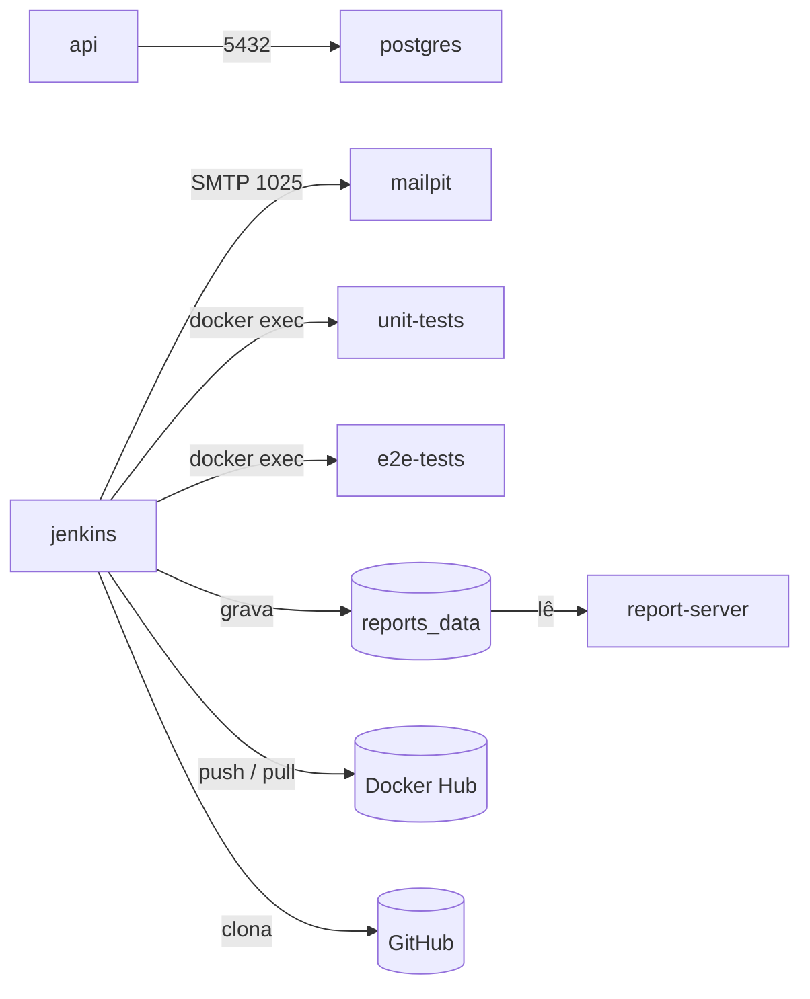

# Red & Green Cassino - API Backend

API do cassino Red & Green. Concentra a lógica dos jogos (**Slot Machine** e **Gambit**), a geração de resultados, a carteira de fichas e a autenticação dos jogadores, isolando todas as regras de negócio do frontend.

Este repositório também contém toda a infraestrutura DevOps do projeto, definida como código: **Dockerfiles**, **Docker Compose**, **Jenkins em container** (JCasC + Job DSL) e o **Jenkinsfile** do pipeline de CI/CD.

| Item                          | Link / Valor                                                                                         |
| ----------------------------- | ---------------------------------------------------------------------------------------------------- |
| Repositório                   | [Cassino-RedGreen/RedGreen-Back](https://github.com/Cassino-RedGreen/RedGreen-Back)                  |
| Imagem Docker Hub (Jenkins)   | [hub.docker.com/r/antoniofsn2/redgreen-back](https://hub.docker.com/r/antoniofsn2/redgreen-back)     |
| Tag estável                   | `antoniofsn2/redgreen-back:jenkins-latest`                                                           |
| Cobertura de testes unitários | 99,21% statements · 92,12% branches · 100% functions · 99,17% lines (limite mínimo configurado: 90%) |
| Frontend                      | [Cassino-RedGreen/RedGreen-Front](https://github.com/Cassino-RedGreen/RedGreen-Front)                |

---

## Resumo rápido

- **O que é:** API NestJS + PostgreSQL de um cassino com dois jogos (Slot Machine e Gambit), autenticação JWT, carteira de fichas e sessão única por jogador.
- **Como sobe:** `docker compose up -d --build` levanta 8 containers: `postgres`, `api`, `unit-tests` e `e2e-tests` (Dockerfiles locais), `jenkins` (Docker Hub), `mailpit`, `report-server` e `report-volume-init`. O runner k6 `performance` é opcional.
- **Pipeline:** Jenkins em container, configurado só por código (`Jenkinsfile` + `jenkins/casc.yaml`). Roda qualidade → testes unitários (falha abaixo de 90% de cobertura) → build e pacote `.tar.gz` → 25 testes E2E → publicação da imagem no Docker Hub → e-mail de resultado.
- **E-mail:** enviado por `scripts/send-pipeline-email.py`, com destinatário em `EMAIL_TO` no `.env` (nada fixo no código). Localmente, chega no Mailpit.
- **Artefatos:** pacote da API, relatórios JUnit, cobertura e E2E arquivados no Jenkins e navegáveis em `http://localhost:8088`.
- **Docker Hub:** imagem do Jenkins em `antoniofsn2/redgreen-back`, com as tags `jenkins-latest` e `jenkins-<build>-<commit>`.
- **Volumes:** `postgres_data` (banco), `jenkins_home` (Jenkins) e `reports_data` (relatórios).
- **Testes:** 224 unitários (Jest), 25 cenários de API (Newman), 3 cenários de carga (k6) e 7 testes dos scripts de CI.

---

## Índice

- [Resumo rápido](#resumo-rápido)
- [Requisitos da NP2 → onde estão no repositório](#requisitos-da-np2--onde-estão-no-repositório)
- [Funcionalidades](#funcionalidades)
- [Tecnologias e Ferramentas](#tecnologias-e-ferramentas)
- [Arquitetura](#arquitetura)
- [Estrutura do Projeto](#estrutura-do-projeto)
- [Pré-requisitos](#pré-requisitos)
- [Variáveis de Ambiente](#variáveis-de-ambiente)
- [Executando o Projeto](#executando-o-projeto)
- [Docker Compose](#docker-compose)
- [Pipeline CI/CD (Jenkins)](#pipeline-cicd-jenkins)
- [Docker Hub](#docker-hub)
- [Testes](#testes)
- [Como validar a entrega do zero](#como-validar-a-entrega-do-zero)
- [Comandos Importantes](#comandos-importantes)
- [Documentação da API](#documentação-da-api)
- [Uso de IA](#uso-de-ia)
- [Histórico do projeto (entregas anteriores)](#histórico-do-projeto-entregas-anteriores)
- [Autores](#autores)

---

## Requisitos da NP2 → onde estão no repositório

| Requisito                                        | Onde está                                                                                                                                                                            |
| ------------------------------------------------ | ------------------------------------------------------------------------------------------------------------------------------------------------------------------------------------ |
| Cobertura de testes ≥ 90%                        | Limite global de 90% em `coverageThreshold` no [`package.json`](package.json); a etapa **Unit Tests** falha abaixo disso. Cobertura atual: ver [Testes](#testes).                    |
| Jenkins em modo container                        | [`docker/Dockerfile.jenkins`](docker/Dockerfile.jenkins) + serviço `jenkins` no [`docker-compose.yml`](docker-compose.yml).                                                          |
| Pipeline sem interface gráfica                   | Etapas no [`Jenkinsfile`](Jenkinsfile); job, credenciais e admin em [`jenkins/casc.yaml`](jenkins/casc.yaml) (JCasC + Job DSL) e [`jenkins/init.groovy.d/`](jenkins/init.groovy.d/). |
| Sem GitHub Actions                               | Não há `.github/workflows/` neste repositório; o workflow antigo foi removido no commit `9e1bed0`.                                                                                   |
| Etapa de testes                                  | `Unit Tests` (Jest + cobertura) e `E2E Tests` (Newman contra API + PostgreSQL reais) no [`Jenkinsfile`](Jenkinsfile).                                                                |
| Etapa de build / empacotamento                   | `Build & Package`: imagem da API + artefato `redgreen-back-<tag>.tar.gz`.                                                                                                            |
| Notificação por e-mail via script                | `post { always }` chama [`scripts/send-pipeline-email.py`](scripts/send-pipeline-email.py) (Python + `smtplib`).                                                                     |
| E-mail não hardcoded                             | Destinatário em `EMAIL_TO` (e `EMAIL_FROM`, `SMTP_*`) no `.env`, injetado no container do Jenkins via `env_file`.                                                                    |
| Pacote e relatório de testes como artefatos      | `archiveArtifacts` de `reports/**`, `redgreen-back-<tag>.tar.gz` e `test-results/**`; JUnit publicado no Jenkins.                                                                    |
| Softwares do pipeline instalados via Dockerfile  | Docker CLI, Node 24, Python 3 e plugins (via [`jenkins/plugins.txt`](jenkins/plugins.txt)) no `Dockerfile.jenkins`; k6 no `Dockerfile.performance`.                                  |
| Imagem publicada no Docker Hub                   | Etapas `Build & Publish Jenkins Image` e `Verify Jenkins Image from Docker Hub`. Ver [Docker Hub](#docker-hub).                                                                      |
| Docker Compose com 4+ containers                 | 8 serviços no `docker-compose.yml` (+ runner de performance opcional). Ver [Docker Compose](#docker-compose).                                                                        |
| Container de Dockerfile local + container do Hub | `postgres`, `api`, `unit-tests` e `e2e-tests` são construídos localmente; `jenkins` é puxado do Docker Hub.                                                                          |
| Comunicação entre containers                     | `api → postgres`, `jenkins → mailpit` (SMTP), `jenkins → runners` (`docker exec`), `report-server` lê os relatórios gravados pelo Jenkins.                                           |
| Volumes para persistência                        | `postgres_data` (banco), `jenkins_home` (configuração e histórico) e `reports_data` (relatórios compartilhados).                                                                     |
| README e Uso de IA                               | Este arquivo. Ver [Uso de IA](#uso-de-ia).                                                                                                                                           |

---

## Funcionalidades

- **Autenticação:** cadastro, login e perfil com JWT (expira em 1h).
- **Carteira:** controle transacional das fichas (chips), bônus diário e ranking dos 10 maiores saldos.
- **Slot Machine:** giro, reroll de um rolo específico e cash-out, com cálculo de prêmios no servidor.
- **Gambit:** jogo de cartas original do grupo (queima de cartas, eventos, efeitos e liquidação), também calculado no servidor.
- **Sessão única de plataforma:** um jogador só pode ter **uma partida ativa por vez**, em qualquer jogo. Tentar abrir outra retorna `409`.
- **Administração:** CRUD de mesas, consulta de sessões ativas e desativação de mesas com encerramento automático das sessões (pagamento ou reembolso).

### Rotas principais

| Módulo                  | Rotas                                                                                                                                                                  |
| ----------------------- | ---------------------------------------------------------------------------------------------------------------------------------------------------------------------- |
| Raiz                    | `GET /` (health check usado pelos containers)                                                                                                                          |
| Auth (públicas)         | `POST /auth/register`, `POST /auth/login`, `GET /auth/check-email`, `GET /auth/rank`                                                                                   |
| Usuário (JWT)           | `GET /user/profile`, `GET /user/chips`, `POST /user/daily-login`, `PATCH /user`, `PATCH /user/reactivate`, `DELETE /user`                                              |
| Slot Machine            | `GET /slot/machine`, `GET /slot/machine/:Id`; admin: `POST`, `PUT /:Id`, `PATCH /:Id/deactivate`, `DELETE /:Id`                                                        |
| Sessões de Slot (JWT)   | `POST /slot-machines/:slotMachineId/sessions`, `GET /sessions/active`, `POST /sessions/active/reroll/:reelIndex`, `POST /sessions/active/cash-out`                     |
| Gambit                  | `GET /gambit-table`, `GET /gambit-table/:Id`; admin: `POST`, `PATCH /:Id`, `PATCH /:Id/deactivate`, `DELETE /:Id`                                                      |
| Sessões de Gambit (JWT) | `POST /gambit-tables/:GambitTableId/sessions`, `GET /gambit/sessions/active`, `POST /gambit/sessions/active/{burn/:position, resolve-event, resolve-effect, cash-out}` |
| Sessão ativa (JWT)      | `GET /sessions/me/active` (em qual jogo o usuário está)                                                                                                                |
| Admin de sessões        | `GET /admin/{slot-machines,gambit-tables}/:Id/active-sessions`, `POST /admin/{slot-machines,gambit-tables}/:Id/deactivate`                                             |

A lista completa, com payloads e respostas, está no [Swagger](#documentação-da-api).

---

## Tecnologias e Ferramentas

| Categoria                    | Ferramentas                                                    |
| ---------------------------- | -------------------------------------------------------------- |
| **Core**                     | NestJS 11, TypeScript, Node.js 24                              |
| **Banco de Dados / ORM**     | PostgreSQL 15, TypeORM                                         |
| **Autenticação**             | JWT (`@nestjs/jwt`), Passport, bcrypt                          |
| **Validação**                | class-validator, class-transformer                             |
| **Documentação**             | Swagger (OpenAPI)                                              |
| **Testes**                   | Jest + ts-jest, Newman/Postman, k6, node:test                  |
| **Qualidade e Padronização** | ESLint, Prettier, Husky, Commitlint, lint-staged               |
| **Containers**               | Docker, Docker Compose                                         |
| **CI/CD**                    | Jenkins (em container), Jenkins Configuration as Code, Job DSL |
| **Registro de imagens**      | Docker Hub                                                     |
| **Notificação**              | Script Python (`smtplib`) + Mailpit (SMTP local)               |
| **Relatórios de CI**         | Jenkins artifacts + JUnit + servidor estático Nginx            |

---

## Arquitetura

O projeto segue uma **arquitetura em camadas (layered/clean)**, organizada por domínio. Cada módulo é dividido em:

- **`domain/`**: entidades (tabelas), DTOs, tipos e enums.
- **`application/`**: regras de negócio (services) e o motor dos jogos. **É esta camada que a métrica de cobertura mede.**
- **`presentation/`**: controladores HTTP (rotas) e anotações do Swagger.
- **`infrastructure/`**: integrações externas (no módulo `auth`, a estratégia JWT do Passport).

| Módulo             | Responsabilidade                                                                        |
| ------------------ | --------------------------------------------------------------------------------------- |
| **`auth`**         | Autenticação (JWT), usuários, carteira de fichas, bônus diário e ranking.               |
| **`slot-machine`** | Jogo Slot Machine e suas sessões.                                                       |
| **`gambit`**       | Jogo Gambit (motor de cartas: queima, eventos e efeitos) e suas sessões.                |
| **`sessions`**     | Registro de sessão única por usuário (lock de plataforma via `SessionRegistryService`). |

Código transversal (decorators, filters, guards e o seed do banco) fica em `src/core/`.

---

## Estrutura do Projeto

```text
RedGreen-Back/
├── Jenkinsfile                      # Etapas do pipeline de CI/CD
├── docker-compose.yml               # Stack completa (8 serviços + performance opcional)
├── docker-compose.bootstrap.yml     # Override para construir o Jenkins localmente na 1ª vez
├── .env.example                     # Modelo das variáveis de ambiente
│
├── docker/
│   ├── Dockerfile.api               # API (build multi-stage, Node 24)
│   ├── Dockerfile.database          # PostgreSQL 15 + healthcheck
│   ├── Dockerfile.jenkins           # Jenkins LTS + Docker CLI + Node + Python + plugins
│   ├── Dockerfile.unit-tests        # Runner dos testes unitários
│   ├── Dockerfile.e2e-tests         # Runner dos testes E2E (Newman)
│   ├── Dockerfile.performance       # Runner k6 (opcional)
│   └── report-server/               # Configuração e página inicial do Nginx de relatórios
│
├── jenkins/
│   ├── casc.yaml                    # JCasC: admin, credenciais e job multibranch (Job DSL)
│   ├── plugins.txt                  # Plugins instalados na imagem
│   └── init.groovy.d/               # Criação do usuário admin na inicialização
│
├── scripts/
│   ├── send-pipeline-email.py       # Envio do e-mail de resultado do pipeline
│   ├── build-ci-report-index.cjs    # Páginas HTML de resumo dos relatórios
│   ├── run-all-tests.cjs            # Executa todos os cenários de API (test:all)
│   ├── write-e2e-summary.cjs        # Gera o summary.json da execução E2E
│   └── patch-newman.cjs             # Ajustes de compatibilidade do Newman (postinstall)
│
├── src/
│   ├── main.ts                      # Bootstrap (Nest + Swagger + ValidationPipe)
│   ├── app.module.ts                # Módulo raiz (TypeORM, JWT e módulos)
│   ├── seed.ts                      # Execução manual do seed
│   ├── core/                        # Decorators, filters, guards e seed do banco
│   └── modules/
│       ├── auth/
│       ├── slot-machine/
│       ├── gambit/
│       └── sessions/
│
└── test/
    ├── *.spec.ts                    # Testes unitários (Jest)
    ├── api/                         # Coleção Postman, ambiente e runners Newman (TC-001 a TC-025)
    ├── performance/                 # Cenários k6 e run-all.cjs
    └── tooling/                     # Testes dos scripts de CI (node:test)
```

---

## Pré-requisitos

- **Docker Desktop** (ou Docker Engine) com **Docker Compose v2**. É o único requisito para subir a stack completa e o pipeline.
- **Node.js 24** (versão fixada em [`.node-version`](.node-version)): necessário apenas para rodar a API ou os testes **fora** dos containers.
- Conta e **access token do Docker Hub**: necessários apenas para publicar a imagem do Jenkins.

---

## Variáveis de Ambiente

Todas ficam no `.env` (modelo em [`.env.example`](.env.example)). O `.env` está no `.gitignore` e **nunca deve ser commitado**.

```bash
cp .env.example .env
```

### Obrigatórias

| Variável                                            | Quem exige               | Descrição                                                                                      |
| --------------------------------------------------- | ------------------------ | ---------------------------------------------------------------------------------------------- |
| `JWT_SECRET`                                        | Compose (`:?`) e API     | Segredo usado para assinar os tokens. Substitua o valor do exemplo por um valor forte.         |
| `JENKINS_ADMIN_USER`, `JENKINS_ADMIN_PASSWORD`      | Compose (`:?`)           | Admin do Jenkins criado por código. Senha forte, com 16+ caracteres.                           |
| `POSTGRES_USER`, `POSTGRES_PASSWORD`, `POSTGRES_DB` | API                      | Credenciais do PostgreSQL (também usadas na stack E2E do pipeline).                            |
| `EMAIL_TO`                                          | `send-pipeline-email.py` | Destinatários do e-mail do pipeline, separados por vírgula.                                    |
| `EMAIL_FROM`, `SMTP_HOST`, `SMTP_PORT`              | `send-pipeline-email.py` | Remetente e servidor SMTP. O padrão envia para o Mailpit local (`mailpit:1025`).               |
| `DOCKER_SOCKET_GID`                                 | Compose                  | Grupo do socket do Docker: `0` no Docker Desktop; no Linux, `stat -c %g /var/run/docker.sock`. |

### Para publicar no Docker Hub

| Variável                                | Descrição                                                                                    |
| --------------------------------------- | -------------------------------------------------------------------------------------------- |
| `DOCKERHUB_USERNAME`, `DOCKERHUB_TOKEN` | Viram a credencial `dockerhub` do Jenkins (via JCasC). O token nunca aparece no Jenkinsfile. |
| `JENKINS_IMAGE_REPO`                    | Repositório de destino. Padrão: `antoniofsn2/redgreen-back`.                                 |

### Opcionais (têm valor padrão)

| Variável                                         | Padrão                                          |
| ------------------------------------------------ | ----------------------------------------------- |
| `POSTGRES_HOST`, `POSTGRES_PORT`, `POSTGRES_SSL` | `localhost`, `5433`, `false`                    |
| `PORT`                                           | `3000`                                          |
| `JENKINS_IMAGE`                                  | `antoniofsn2/redgreen-back:jenkins-latest`      |
| `JENKINS_PORT`, `JENKINS_PUBLIC_URL`             | `8080`, `http://localhost:8080/`                |
| `MAILPIT_UI_PORT`                                | `8025`                                          |
| `REPORT_SERVER_PORT`, `REPORT_SERVER_URL`        | `8088`, `http://localhost:8088`                 |
| `SMTP_USER`, `SMTP_PASSWORD`, `SMTP_STARTTLS`    | vazios / `false` (Mailpit não usa autenticação) |
| `TEST_DB_POOL_SIZE`                              | `5`                                             |

> Para enviar e-mails reais (fora do ambiente local), troque `EMAIL_TO` pelos destinatários reais e aponte `SMTP_*` para um servidor SMTP de verdade. Nenhum endereço fica fixo no código.

---

## Executando o Projeto

Há dois jeitos de rodar: **só a API** (para desenvolver) ou a **stack completa** com Jenkins (para a entrega da NP2, descrita em [Docker Compose](#docker-compose)).

### Só a API (desenvolvimento)

```bash
cp .env.example .env            # defina um JWT_SECRET
npm install
docker compose up -d --wait postgres
npm run start:dev
```

- API: `http://localhost:3000`
- Swagger: `http://localhost:3000/api`
- PostgreSQL no host: `localhost:5433`

Na inicialização, o [`DatabaseSeedService`](src/core/database/database-seed.service.ts) cria ou atualiza o administrador e as mesas oficiais:

| Recurso           | Valores                                             |
| ----------------- | --------------------------------------------------- |
| Administrador     | `admin@admin.com` / `admin123`, com 10.000 fichas   |
| Slot 0            | Saldo mínimo 0, giro 10, reroll 5                   |
| Slot 1            | Saldo mínimo 100, giro 10, reroll 5                 |
| Slot 2            | Saldo mínimo 500, giro 20, reroll 10                |
| Slot 3            | Saldo mínimo 600, giro 30, reroll 15                |
| Gambit 1          | Saldo mínimo 100, carta 10, compra de 5 a 20 cartas |
| Gambit 2          | Saldo mínimo 200, carta 15, compra de 5 a 20 cartas |
| Gambit 3          | Saldo mínimo 100, carta 20, compra de 7 a 20 cartas |
| High Stake Gambit | Saldo mínimo 100, carta 10, compra de 5 a 25 cartas |

> Essas credenciais são apenas dados de desenvolvimento. O seed reaplica saldo e senha do admin; não o execute (`npm run seed`) durante uma suíte de testes.

---

## Docker Compose

O [`docker-compose.yml`](docker-compose.yml) (projeto `redgreen-back`) sobe toda a infraestrutura da NP2.

### Containers

| Serviço                    | Origem da imagem                                            | Porta no host    | Volumes                                          | Função                                              |
| -------------------------- | ----------------------------------------------------------- | ---------------- | ------------------------------------------------ | --------------------------------------------------- |
| `postgres`                 | **Dockerfile local** (`docker/Dockerfile.database`)         | `5433`           | `postgres_data`                                  | Banco de dados da API.                              |
| `api`                      | **Dockerfile local** (`docker/Dockerfile.api`)              | `3000`           | —                                                | API NestJS.                                         |
| `unit-tests`               | **Dockerfile local** (`docker/Dockerfile.unit-tests`)       | —                | —                                                | Runner onde o Jenkins executa o Jest.               |
| `e2e-tests`                | **Dockerfile local** (`docker/Dockerfile.e2e-tests`)        | —                | —                                                | Runner onde o Jenkins executa o Newman.             |
| `jenkins`                  | **Docker Hub** (`antoniofsn2/redgreen-back:jenkins-latest`) | `127.0.0.1:8080` | `jenkins_home`, `reports_data`, socket do Docker | Servidor de CI/CD.                                  |
| `mailpit`                  | `axllent/mailpit:v1.27`                                     | `127.0.0.1:8025` | —                                                | Servidor SMTP local e caixa de entrada dos e-mails. |
| `report-server`            | `nginx:1.29-alpine`                                         | `127.0.0.1:8088` | `reports_data` (somente leitura)                 | Site navegável com os relatórios de cada build.     |
| `report-volume-init`       | `alpine:3.22` (executa uma vez e termina)                   | —                | `reports_data`                                   | Cria as pastas de relatórios e ajusta permissões.   |
| `performance` _(opcional)_ | **Dockerfile local** (`docker/Dockerfile.performance`, k6)  | —                | bind `./test/performance/artifacts`              | Runner dos testes de carga (profile `performance`). |

As portas do Jenkins, do Mailpit e dos relatórios são publicadas só em `127.0.0.1`, então não ficam acessíveis por outras máquinas da rede.

### Comunicação entre containers



- **`api → postgres`**: a API acessa o banco pelo nome do serviço (`POSTGRES_HOST=postgres`). A API só sobe quando o banco está `healthy`.
- **`jenkins → runners`**: o Jenkins controla o Docker do host pelo socket montado e executa os testes com `docker exec` nos runners, encontrados pelos labels do Compose.
- **`jenkins → mailpit`**: o script de e-mail envia a mensagem por SMTP para `mailpit:1025`.
- **`jenkins → report-server`**: os dois compartilham o volume `reports_data`; o Jenkins grava e o Nginx serve.
- **Na etapa E2E**, o Jenkins cria uma rede isolada por build (`redgreen-ci-<branch>-<n>-net`), sobe nela um PostgreSQL e a imagem da API recém-construída, e conecta o runner E2E, que chama `http://api:3000`.

### Volumes

| Volume          | Persiste                                                       |
| --------------- | -------------------------------------------------------------- |
| `postgres_data` | Dados do PostgreSQL.                                           |
| `jenkins_home`  | Configuração, jobs e histórico de builds do Jenkins.           |
| `reports_data`  | Relatórios unitários, de cobertura e E2E publicados por build. |

### Subindo e parando

```bash
# Primeira vez (a imagem do Jenkins ainda não existe no Docker Hub)
docker compose -f docker-compose.yml -f docker-compose.bootstrap.yml up -d --build

# Uso normal (Jenkins puxado do Docker Hub)
docker compose up -d --build

# Acompanhar
docker compose ps
docker compose logs -f jenkins

# Parar (mantém os volumes)
docker compose --profile performance down

# Parar e apagar banco, histórico do Jenkins e relatórios (irreversível)
docker compose --profile performance down -v
```

Ao mudar variáveis no `.env`, recrie os serviços com `docker compose up -d --build --force-recreate`.

| Serviço    | Endereço                | Observação                                                 |
| ---------- | ----------------------- | ---------------------------------------------------------- |
| API        | `http://localhost:3000` | Swagger em `/api`.                                         |
| Jenkins    | `http://localhost:8080` | Login com `JENKINS_ADMIN_USER` / `JENKINS_ADMIN_PASSWORD`. |
| Mailpit    | `http://localhost:8025` | E-mails enviados pelo pipeline.                            |
| Relatórios | `http://localhost:8088` | Cobertura, unitários e E2E de cada build.                  |

---

## Pipeline CI/CD (Jenkins)

O Jenkins roda **em container** e é configurado **somente por código**:

- **Imagem:** [`docker/Dockerfile.jenkins`](docker/Dockerfile.jenkins) parte do `jenkins/jenkins:lts-jdk21` e instala Docker CLI, Node 24, Python 3 e os plugins de [`jenkins/plugins.txt`](jenkins/plugins.txt). O assistente de configuração inicial é desativado.
- **Configuração:** [`jenkins/casc.yaml`](jenkins/casc.yaml) (JCasC) cria o admin, as credenciais (`postgres-password`, `jwt-secret`, `smtp-password`, `dockerhub`) e, via Job DSL, o job multibranch `RedGreen-Back`.
- **Etapas:** todas no [`Jenkinsfile`](Jenkinsfile). A interface gráfica é usada apenas para disparar o checkout (**Scan Repository Now**) e acompanhar os builds.

O job lê o repositório do **GitHub** (não a cópia local) e verifica novas branches a cada 5 minutos. Mudanças só entram no pipeline depois do `git push`.

### Parâmetros

| Parâmetro         | Padrão  | Efeito                                                                 |
| ----------------- | ------- | ---------------------------------------------------------------------- |
| `RUN_PERFORMANCE` | `false` | Executa a suíte k6 (exige o runner `performance` rodando).             |
| `PUBLISH_IMAGE`   | `false` | Publica a imagem do Jenkins a partir de uma branch que não é a `main`. |

### Etapas

| Etapa                                | O que faz                                                                                                  |
| ------------------------------------ | ---------------------------------------------------------------------------------------------------------- |
| Prepare                              | Define nomes únicos por build, a tag `<build>-<commit>` e empacota o código para os runners.               |
| Install Dependencies                 | `npm ci`.                                                                                                  |
| Quality (paralelo)                   | `lint:check`, `format:check` e `npm audit --audit-level=high`.                                             |
| **Unit Tests**                       | Executa `npm run test:cov` no runner `unit-tests`. **Falha se a cobertura ficar abaixo de 90%.**           |
| **Build & Package**                  | Constrói a imagem da API e gera o artefato `redgreen-back-<tag>.tar.gz` (`dist/` + `package*.json`).       |
| **E2E Tests**                        | Sobe PostgreSQL e API isolados e executa os 25 cenários Newman (`npm run test:all`) no runner `e2e-tests`. |
| Performance Tests                    | Opcional (`RUN_PERFORMANCE`): três cenários k6 no runner `performance`.                                    |
| Build & Publish Jenkins Image        | Na `main` automaticamente, ou em outra branch com `PUBLISH_IMAGE`. Ver [Docker Hub](#docker-hub).          |
| Verify Jenkins Image from Docker Hub | Faz `pull` da tag recém-publicada, sobe um Jenkins descartável sem rede e testa o endpoint `/login`.       |
| **Pós-build (`always`)**             | Remove containers e rede de teste, **envia o e-mail de resultado** e limpa o workspace.                    |

### Artefatos arquivados

| Artefato                                                                               | Tipo          | Se faltar                                        |
| -------------------------------------------------------------------------------------- | ------------- | ------------------------------------------------ |
| `redgreen-back-<tag>.tar.gz` (com fingerprint)                                         | Pacote        | `FAILURE`                                        |
| `reports/unit/junit.xml` e `reports/unit/coverage/` (lcov-report, Cobertura XML, HTML) | Obrigatório   | `FAILURE`                                        |
| `test-results/<timestamp>/summary.json` e o JSON do Newman de cada cenário             | Obrigatório   | `FAILURE`                                        |
| `test-results/<timestamp>/junit-*.xml`                                                 | Opcional      | `UNSTABLE` (só se nenhum existir)                |
| `performance-results/**`                                                               | Se habilitado | Arquivado quando `RUN_PERFORMANCE` estiver ativo |

Os resultados JUnit também são publicados na interface do Jenkins, e os relatórios unitários e E2E são copiados para o volume `reports_data`, ficando navegáveis em `http://localhost:8088`:

- **Unitários:** `/reports/unit/<build>/index.html`
- **Cobertura:** `/reports/unit/<build>/coverage/lcov-report/index.html`
- **E2E:** `/reports/e2e/<build>/index.html`

### Notificação por e-mail

O bloco `post { always }` do Jenkinsfile executa:

```bash
python3 scripts/send-pipeline-email.py
```

O [script](scripts/send-pipeline-email.py) usa `smtplib` e envia uma mensagem em texto e HTML com: status do build, etapa que falhou, branch, commit, duração, imagem publicada, totais dos testes (JUnit), relatórios ausentes e links para o servidor de relatórios.

- Destinatário e servidor vêm **só de variáveis de ambiente** (`EMAIL_TO`, `EMAIL_FROM`, `SMTP_HOST`, `SMTP_PORT`, `SMTP_USER`, `SMTP_STARTTLS`). A senha SMTP chega pela credencial `smtp-password` do JCasC.
- O `.env` é injetado no container do Jenkins via `env_file`, então nada fica fixo no Jenkinsfile.
- Se o envio falhar, o build falha: a notificação é obrigatória.
- Localmente, o e-mail aparece no Mailpit em `http://localhost:8025`.

---

## Docker Hub

A imagem publicada é a do **Jenkins**, construída a partir de [`docker/Dockerfile.jenkins`](docker/Dockerfile.jenkins):

**[hub.docker.com/r/antoniofsn2/redgreen-back](https://hub.docker.com/r/antoniofsn2/redgreen-back)**

```bash
docker pull antoniofsn2/redgreen-back:jenkins-latest
```

| Tag                        | Quando é publicada                    |
| -------------------------- | ------------------------------------- |
| `jenkins-<build>-<commit>` | Em todo build que publica (imutável). |
| `jenkins-latest`           | Apenas em builds da `main`.           |

O login usa a credencial `dockerhub` (access token), e o `docker logout` é feito ao final da etapa. Depois do push, a etapa **Verify Jenkins Image from Docker Hub** baixa a tag publicada e confirma que o Jenkins sobe e responde.

### Bootstrap (dependência circular da primeira publicação)

O serviço `jenkins` do Compose sempre puxa a imagem do Docker Hub. Na primeira vez, porém, essa imagem ainda não existe. Por isso:

1. Suba a stack com o override que constrói o Jenkins localmente:
   ```bash
   docker compose -f docker-compose.yml -f docker-compose.bootstrap.yml up -d --build
   ```
2. Execute o pipeline da `main` (ou de uma branch com `PUBLISH_IMAGE`). Ele publica a imagem no Docker Hub.
3. Passe a usar a imagem do Hub:
   ```bash
   docker compose pull jenkins
   docker compose up -d --force-recreate jenkins
   ```

A partir daí, o próprio pipeline roda em um Jenkins vindo do Docker Hub. Para testar a tag de uma branch, defina `JENKINS_IMAGE=antoniofsn2/redgreen-back:jenkins-<build>-<commit>` no `.env`.

---

## Testes

| Tipo              | Ferramenta     | Quantidade                        | Comando                                                    | No pipeline                  |
| ----------------- | -------------- | --------------------------------- | ---------------------------------------------------------- | ---------------------------- |
| Unitários         | Jest + ts-jest | 8 suítes, **224 testes**          | `npm run test:cov`                                         | Unit Tests                   |
| API / E2E         | Newman/Postman | **25 cenários** (TC-001 a TC-025) | `npm run test:all`                                         | E2E Tests                    |
| Performance       | k6             | 3 cenários                        | `npm run test:performance` / `npm run compose:performance` | Performance Tests (opcional) |
| Ferramentas de CI | node:test      | 7 testes                          | `npm run test:tooling`                                     | —                            |

> **Testadores de caixa cinza:** os integrantes que elaboraram e executaram os testes automatizados atuaram como testadores de caixa cinza, com conhecimento parcial da estrutura interna da aplicação (API, regras de negócio e dados de teste), usado para definir os cenários e validar os resultados.

### Cobertura

| Statements       | Branches         | Functions    | Lines            |
| ---------------- | ---------------- | ------------ | ---------------- |
| 99,21% (756/762) | 92,12% (386/419) | 100% (98/98) | 99,17% (719/725) |

- A cobertura mede a camada de regras de negócio: `src/modules/**/application/**/*.ts` (os services de auth, slot-machine, slot-session, gambit-table, gambit-session e session-registry).
- O limite global é **90% nas quatro métricas** (`coverageThreshold` no `package.json`). Abaixo disso, o Jest falha e a etapa **Unit Tests** quebra o build.
- Relatórios em `reports/unit/coverage/` (HTML navegável em `lcov-report/index.html` e XML Cobertura para o Jenkins).

### Testes unitários

Repositórios, transações e dependências são simulados por injeção de dependência; essa suíte não precisa de PostgreSQL.

| Arquivo                                                                   | Funcionalidades verificadas                                                                |
| ------------------------------------------------------------------------- | ------------------------------------------------------------------------------------------ |
| [auth.service.spec.ts](test/auth.service.spec.ts)                         | Cadastro, login, perfil, atualização, bônus diário e validações do usuário.                |
| [slot-machine.service.spec.ts](test/slot-machine.service.spec.ts)         | Criação, edição, remoção e validação de mesas Slot.                                        |
| [slot-session.service.spec.ts](test/slot-session.service.spec.ts)         | Cálculo de prêmios, geração de símbolos, criação de sessão, reroll e cash-out.             |
| [gambit-table.service.spec.ts](test/gambit-table.service.spec.ts)         | Criação, consulta, edição, remoção e desativação de mesas Gambit.                          |
| [gambit-session.service.spec.ts](test/gambit-session.service.spec.ts)     | Multiplicadores, tabuleiro, queima de cartas, efeitos, eventos e liquidação da partida.    |
| [session-registry.service.spec.ts](test/session-registry.service.spec.ts) | Aquisição e liberação da sessão única de plataforma.                                       |
| [session-management.spec.ts](test/session-management.spec.ts)             | Conflito de sessões, concorrência e desativação administrativa com pagamento ou reembolso. |
| [app.controller.spec.ts](test/app.controller.spec.ts)                     | Resposta da rota raiz.                                                                     |

### Cenários de API (Newman)

A coleção [redgreen-api.postman_collection.json](test/api/redgreen-api.postman_collection.json) contém 25 cenários executados contra a API e o PostgreSQL reais.

| Caso     | Funcionalidade / resultado esperado                                       |
| :------- | :------------------------------------------------------------------------ |
| `TC-001` | Acesso a jogos sem autenticação é recusado.                               |
| `TC-002` | Jogador comum não pode executar funções administrativas.                  |
| `TC-003` | Administrador consegue executar funções restritas.                        |
| `TC-004` | Bônus diário não pode ser resgatado duas vezes no mesmo dia.              |
| `TC-005` | Um jogador não pode usar a sessão de outro.                               |
| `TC-006` | Administrador cria e configura uma mesa ativa.                            |
| `TC-007` | Ranking exibe os jogadores na ordem esperada de saldo.                    |
| `TC-008` | Conclusão de Slot e entrada no Gambit com o saldo atualizado.             |
| `TC-009` | Bloqueio de duas sessões simultâneas de Slot para o mesmo usuário.        |
| `TC-010` | Sessão ativa em um jogo bloqueia a entrada no outro.                      |
| `TC-011` | Bônus completa o saldo mínimo e libera a sessão de Slot.                  |
| `TC-012` | Exclusão de mesa somente após o cash-out administrativo.                  |
| `TC-013` | Reroll cobra o valor da mesa e é recusado sem saldo ou tentativas.        |
| `TC-014` | Gambit não expõe cartas ainda não reveladas.                              |
| `TC-015` | Edição da mesa afeta sessões futuras e preserva a configuração da atual.  |
| `TC-016` | Reautenticação recupera e permite continuar a sessão de Slot.             |
| `TC-017` | Reautenticação recupera e permite continuar a sessão de Gambit.           |
| `TC-018` | Dois jogadores usam a mesma mesa de Slot com estados independentes.       |
| `TC-019` | Dois jogadores usam a mesma mesa de Gambit com estados independentes.     |
| `TC-020` | Dois clientes do mesmo usuário compartilham o estado da sessão de Slot.   |
| `TC-021` | Dois clientes do mesmo usuário compartilham o estado da sessão de Gambit. |
| `TC-022` | Falha de reautenticação preserva a sessão de Slot.                        |
| `TC-023` | Ação com token inválido preserva a sessão de Gambit.                      |
| `TC-024` | Cash-outs concorrentes de Slot não duplicam o pagamento.                  |
| `TC-025` | Cash-outs concorrentes de Gambit não duplicam o pagamento.                |

#### Rodando localmente (fora do Jenkins)

```bash
npm ci
cp .env.example .env
docker compose up -d --wait postgres
npm run start:dev           # em outro terminal

npm run test:all            # os 25 cenários; continua após falhas e consolida resultados
npm run test:api            # 20 cenários (sem TC-006 a TC-010); para na primeira falha
npm run test:api:tc024      # um cenário específico
```

- `test:all` grava logs, relatórios Newman e `summary.json` em `test-results/<execução>/`. No pipeline, ele roda com `API_BASE_URL=http://api:3000`.
- O ambiente [redgreen.local.postman_environment.json](test/api/redgreen.local.postman_environment.json) deve apontar `baseUrl` para a API e usar as credenciais do admin do seed. Alguns runners atualizam esse arquivo; revise o diff antes de commitar.
- Use uma base destinada a testes: os cenários criam contas e alteram saldos e mesas.

### Testes de performance (k6)

Três cenários em [`test/performance/`](test/performance/): carga sustentada, concorrência de sessões e escala de usuários virtuais. Rodam no container `performance`, sem instalar k6 na máquina:

```bash
npm run compose:performance
```

Os relatórios ficam em `test/performance/artifacts/` (bind mount). No pipeline, a etapa é ativada pelo parâmetro `RUN_PERFORMANCE` e exige o runner rodando (`docker compose --profile performance up -d --build performance`).

> `npm run test:e2e` tem configuração Jest em [jest-e2e.json](test/jest-e2e.json), mas ainda não há arquivos `*.e2e-spec.ts`. A integração HTTP automatizada é feita pelos cenários Newman acima.

---

## Como validar a entrega do zero

Roteiro completo para verificar todos os requisitos (comandos em PowerShell; no Linux/macOS, use `cp` e `curl`).

**1. Configurar o `.env`**

```powershell
Copy-Item .env.example .env
```

Preencha `JWT_SECRET`, `JENKINS_ADMIN_USER`, `JENKINS_ADMIN_PASSWORD` e `EMAIL_TO`. `DOCKERHUB_USERNAME` e `DOCKERHUB_TOKEN` só são necessários para testar a publicação.

**2. Verificar qualidade, testes e build localmente** _(opcional, o pipeline faz o mesmo)_

```powershell
npm ci
npm run lint:check
npm run format:check
npm audit --audit-level=high
npm run test:cov -- --runInBand     # deve passar pelos limites de 90%
npm run build
```

**3. Validar o Compose e subir a stack**

```powershell
docker compose config --quiet
docker compose -f docker-compose.yml -f docker-compose.bootstrap.yml up -d --build   # 1ª vez
docker compose ps
```

**4. Conferir a saúde dos serviços**

```powershell
docker inspect --format '{{.State.Health.Status}}' redgreen-back-jenkins-1
docker inspect --format '{{.State.Health.Status}}' redgreen-back-api-1
docker inspect --format '{{.State.Health.Status}}' redgreen-back-postgres-1
Invoke-WebRequest http://localhost:3000/ -UseBasicParsing
Invoke-WebRequest http://localhost:8080/login -UseBasicParsing
docker compose exec postgres pg_isready -U postgres -d redgreen
```

Os três `inspect` devem retornar `healthy`.

**5. Executar o pipeline**

1. Faça `git push` da branch (o job lê o GitHub, não a cópia local).
2. Acesse `http://localhost:8080`, entre com o admin do `.env` e abra o job `RedGreen-Back`.
3. Clique em **Scan Repository Now**, abra a branch e inicie o build.

**6. Conferir o resultado**

- Etapas de qualidade, testes, build e E2E concluídas com sucesso.
- Artefato `redgreen-back-<tag>.tar.gz` e relatórios unitários/E2E arquivados no build.
- E-mail de resultado no Mailpit (`http://localhost:8025`).
- Relatórios navegáveis em `http://localhost:8088`.
- Na `main` (ou com `PUBLISH_IMAGE`): imagem publicada no Docker Hub e verificada pela etapa seguinte.

---

## Comandos Importantes

| Comando                           | Descrição                                               |
| --------------------------------- | ------------------------------------------------------- |
| `npm run start:dev`               | Sobe a API em modo _watch_.                             |
| `npm run start:prod`              | Sobe a API compilada (`node dist/main`).                |
| `npm run build`                   | Compila o projeto (`nest build`).                       |
| `npm run seed`                    | Executa o seed do banco manualmente.                    |
| `npm test`                        | Testes unitários (Jest).                                |
| `npm run test:cov`                | Testes unitários com cobertura e limite de 90%.         |
| `npm run test:all`                | Os 25 cenários de API, continuando após falhas.         |
| `npm run test:api`                | 20 cenários de API, parando na primeira falha.          |
| `npm run test:api:tcNNN`          | Um cenário de API específico.                           |
| `npm run test:performance`        | Suíte k6 (exige k6 instalado).                          |
| `npm run compose:performance`     | Suíte k6 dentro do container `performance`.             |
| `npm run test:tooling`            | Testes dos scripts de CI.                               |
| `npm run lint` / `lint:check`     | ESLint corrigindo / apenas verificando (usado no CI).   |
| `npm run format` / `format:check` | Prettier formatando / apenas verificando (usado no CI). |

---

## Documentação da API

A documentação interativa (Swagger / OpenAPI) é gerada automaticamente e fica em `/api`. Localmente: `http://localhost:3000/api`.

---

## Uso de IA

O uso de IA foi permitido e incentivado pela disciplina, e aqui declaramos como cada integrante a utilizou.

### Modelos e ferramentas utilizados

| Ferramenta                                 | Usada por                     | Para quê                                                                                    |
| ------------------------------------------ | ----------------------------- | ------------------------------------------------------------------------------------------- |
| ChatGPT                                    | Pedro Ribeiro, Pedro Armengol | Estruturação de cenários de teste, documentação e entendimento das tecnologias.             |
| Codex (OpenAI)                             | Pedro Ribeiro, Pedro Armengol | Implementação e correção do código dos testes.                                              |
| Claude (extensão do VS Code)               | Pedro Henrique                | Escrita das requisições da coleção Postman e dos runners Newman.                            |
| _TODO_                                     | Patrick                       | _TODO_                                                                                      |
| Claude (navegador) e Claude Code (VS Code) | Antonio                       | Estruturação dos prompts e apoio na escrita das configurações de Docker, Compose e Jenkins. |

O arquivo [`AGENTS.MD`](AGENTS.MD) foi escrito para dar contexto do projeto (arquitetura, stack e convenções) aos agentes de IA usados no desenvolvimento. _TODO: confirmar quais agentes o usaram._

### Dinâmica de uso

A IA foi usada em todas as etapas do projeto (código, testes, configuração da infraestrutura e documentação), mas não havia um fluxo único para o grupo: a forma de uso dependia de cada integrante, das ferramentas que ele preferia e da parte em que estava trabalhando. Cada um declara abaixo como a utilizou.

### Prompts reais e o que foi feito com as respostas

| #   | Integrante | Prompt (resumo ou trecho real)                                                                                                                                                                                                                                                                                                                             | Resultado                                                                                                                                                                                                                                                                                                                                                                   |
| --- | ---------- | ---------------------------------------------------------------------------------------------------------------------------------------------------------------------------------------------------------------------------------------------------------------------------------------------------------------------------------------------------------- | --------------------------------------------------------------------------------------------------------------------------------------------------------------------------------------------------------------------------------------------------------------------------------------------------------------------------------------------------------------------------- |
| 1   | Antonio    | Prompt para o Claude Code criar o pipeline Jenkins. Trecho: "ANTES DE ESCREVER QUALQUER ARQUIVO: entre em modo de planejamento, me apresente o plano completo [...] e espere minha aprovação." O prompt listava os requisitos da NP2 e pedia Dockerfile do Jenkins, JCasC + Job DSL, serviços no Compose, Jenkinsfile, script de e-mail e documentação.    | **Ajustado.** O plano foi a base do pipeline, mas a versão final mudou em vários pontos: o Dockerfile do Jenkins ficou em `docker/Dockerfile.jenkins`, a imagem publicada no Docker Hub passou a ser a do Jenkins (e não a da API), o E2E passou a rodar em uma rede isolada criada pelo Jenkinsfile e a documentação foi para este README em vez de um `docs/pipeline.md`. |
| 2   | Antonio    | Prompt para revisar os containers de teste sem mexer no código de outros integrantes. Trecho: "Ajuste o script para que, se o Newman não estiver instalado, ele saia com código 0 [...] Não altere o Dockerfile da API." O prompt também pedia para apenas verificar o healthcheck da API e parar para perguntar antes de mudar scripts do `package.json`. | **Aceito em parte.** O ajuste do `patch-newman.cjs` foi mantido (o script sai com código 0 quando o Newman não está instalado), e a cobertura passou a ser gravada em `reports/unit/coverage/`. Os containers de teste foram depois transformados em runners usados pelo Jenkins.                                                                                           |
| 3   | Patrick    | _TODO_                                                                                                                                                                                                                                                                                                                                                     | _TODO_                                                                                                                                                                                                                                                                                                                                                                      |

### Declarações individuais

As declarações abaixo cobrem o trabalho de infraestrutura e DevOps desta entrega. As dos integrantes que trabalharam na suíte de testes nas entregas anteriores estão em [Uso de IA nas entregas anteriores](#uso-de-ia-nas-entregas-anteriores).

**Patrick Augusto Lins de Oliveira Damião**: _TODO_

**Antonio Feliciano da Silveira Neto**: usei o Claude (Anthropic) como apoio na infraestrutura do projeto (Dockerfiles, Docker Compose, imagem do Jenkins e pipeline). No navegador, eu descrevia o que queria montar e o Claude me ajudava a refinar essa ideia em um prompt mais claro; depois, usava esse prompt na extensão do VS Code para apoiar a escrita das configurações. A execução, a depuração dos erros de build e pipeline e a revisão final foram feitas por mim.

### O que não foi feito por IA

_TODO (grupo): liste as partes desenvolvidas "à mão", por exemplo a concepção e as regras do Gambit, a definição dos casos de teste, decisões de arquitetura etc._

---

## Histórico do projeto (entregas anteriores)

### Histórias de Usuário

#### História 1: Cadastro de usuário · Prioridade: Alta

> Como **visitante**, eu quero criar uma conta com e-mail e senha para que eu possa acessar o cassino e receber meu saldo inicial de fichas.

- **Dado** que estou na tela de cadastro, **quando** preencho e-mail válido e senha forte e confirmo, **então** minha conta é criada e recebo um saldo inicial de fichas.
- **Dado** que informo um e-mail já cadastrado, **quando** submeto, **então** recebo mensagem de erro e o cadastro não é concluído.
- **Dado** que a senha não atende às regras de validação, **quando** submeto, **então** o Zod bloqueia o envio e exibe o erro antes de chamar a API.

#### História 2: Reroll de slot · Prioridade: Alta

> Como **jogador do cassino**, eu quero selecionar um slot específico para realizar um reroll para que eu possa tentar melhorar minha combinação e aumentar minhas chances de obter uma recompensa maior.

- **Dado** que possuo rerolls disponíveis, **quando** seleciono um dos slots permitidos, **então** o sistema destaca visualmente o slot escolhido.
- **Dado** que um slot foi selecionado, **quando** confirmo a ação de reroll, **então** apenas o slot escolhido executa novamente a animação de giro.
- **Dado** que o reroll foi concluído, **quando** o backend retorna o novo resultado, **então** o símbolo exibido no slot corresponde exatamente ao valor recebido.
- **Dado** que um reroll foi utilizado, **quando** a operação é concluída, **então** a quantidade restante de rerolls é atualizada na interface.
- **Dado** que não possuo mais rerolls disponíveis, **quando** tento realizar um novo reroll, **então** o sistema não permite a ação e mantém o estado atual dos slots.

#### História 3: Ranking de jogadores · Prioridade: Média

> Como **jogador competitivo**, eu quero ver um ranking dos jogadores para que eu possa comparar meu desempenho com os demais.

- **Dado** que existem jogadores cadastrados, **quando** acesso a tela de ranking, **então** vejo a lista ordenada pelo saldo de fichas.
- **Dado** que meu saldo é alterado, **quando** o ranking é recalculado, **então** minha posição reflete a mudança.

#### História 4: Bônus diário · Prioridade: Média

> Como **jogador autenticado**, eu quero resgatar meu bônus diário de fichas para que eu possa aumentar meu saldo e continuar jogando.

- **Dado** que estou logado e ainda não resgatei o bônus do dia, **quando** acesso o painel de bônus diário, **então** vejo o dia atual da sequência e posso resgatar a recompensa.
- **Dado** que o bônus diário já foi resgatado, **quando** acesso o painel novamente, **então** o botão de resgate aparece bloqueado com a informação de que o bônus já foi coletado.
- **Dado** que o resgate é concluído com sucesso, **quando** a API retorna a recompensa, **então** o saldo de fichas é atualizado na interface.

#### História 5: Gerenciamento de mesas de jogo · Prioridade: Alta

> Como **administrador**, eu quero criar, editar, desativar e remover mesas de jogo para que eu possa controlar quais mesas estarão disponíveis aos jogadores.

- **Dado** que estou autenticado como administrador, **quando** acesso a tela de mesas, **então** vejo a opção de criar uma nova mesa.
- **Dado** que informo dados inválidos ao criar ou editar uma mesa, **quando** tento salvar, **então** recebo uma mensagem de erro e a operação não é concluída.
- **Dado** que uma mesa está ativa, **quando** tento excluí-la, **então** a exclusão fica bloqueada até que a mesa seja desativada.
- **Dado** que uma mesa possui sessões ativas, **quando** tento desativá-la, **então** o sistema exibe um aviso antes de concluir a operação.

### Metodologia de Desenvolvimento

No começo do projeto não formalizamos uma metodologia específica. Definimos alguns combinados para que o projeto progredisse da melhor maneira possível, adotando, na prática, um fluxo ágil informal e adaptado à realidade do grupo.

Nos dividimos em 3 duplas, em que cada integrante era responsável por validar e testar as Pull Requests da sua dupla. Cada dupla ficou com um aspecto do projeto: uma com o front na parte de Interface e Integração de Usuário, outra com o front na parte de Motor Gráfico e Animações dos jogos, e a última com o backend (Regras de Negócio e Persistência de Dados).

Definimos duas reuniões semanais: na terça-feira, apresentávamos o que fizemos ao longo da semana e alinhávamos as próximas funções; na quinta-feira, nos reuníamos para colocar a mão na massa.

Nosso principal meio de comunicação foi o Discord, onde fazíamos as reuniões. Também usamos o WhatsApp para feedbacks mais informais e o próprio fluxo das PRs no GitHub, onde apontávamos em detalhe o que deveria ser mudado.

Não definimos uma Definição de Pronto (DoD) nem uma Definição de Preparado (DoR), e não tivemos sprints propriamente ditas: trabalhamos com uma cadência fixa de reuniões em vez de ciclos formais.

### Dinâmica de Desenvolvimento

As decisões técnicas foram tomadas, em sua maioria, pelas duplas responsáveis por cada camada, já que cada uma tinha mais contexto sobre o que estava construindo. O feedback dos demais era sempre bem-vindo, principalmente na revisão das Pull Requests. No início, a priorização foi guiada pelos requisitos pedidos no laboratório; depois, pela próxima funcionalidade que cada dupla precisava para destravar seu trabalho.

Para manter o histórico limpo, adotamos um padrão obrigatório de commits e PRs, reforçado por **Husky + Commitlint**. Os commits seguem o formato `tipo: descrição` (`feat:`, `fix:`, `chore:`, `docs:`, `test:`, `refactor:`, `style:`, `ci:`), as branches seguem `tipo/escopo-descrição-curta` (`feat/`, `bugfix/`, `hotfix/`, `chore/`) e as PRs usam o [modelo do repositório](.github/PULL_REQUEST_TEMPLATE) (por que, o que foi feito, como testar e evidências).

O maior desafio veio da criação do Gambit, um jogo completamente original. Por não ser baseado em um jogo existente, muitas regras só se consolidaram ao longo do desenvolvimento, o que gerou atrasos e diversos refactors no backend (regras e persistência) e no front (motor gráfico e fluxo de telas). Essas mudanças também geraram bloqueios pontuais entre as duplas; nesses casos, priorizamos as implementações que destravavam o trabalho dos outros.

A principal lição foi a importância de definir melhor o escopo e as regras de uma funcionalidade original antes de implementá-la, e de formalizar uma Definição de Pronto desde o início para tornar as entregas mais previsíveis.

### Refatorações

As 4 refatorações mais relevantes, cobrindo três tipos do catálogo: **Movimentação**, **Extração** e **Renomeação**.

1. **Movimentação de utilitário entre camadas** (_move Cookies utility from ui to infrastructure_)
   - **Tipo:** Movimentação
   - **Por quê:** move um utilitário para a camada correta, respeitando a arquitetura em camadas.
   - **Commit:** [`bd6c603`](https://github.com/Cassino-RedGreen/RedGreen-Front/commit/bd6c603)
2. **Extração da busca de usuário para hook** (_fetch user from useUserProfile hook_)
   - **Tipo:** Extração
   - **Por quê:** lógica de busca de usuário extraída para um hook reutilizável.
   - **Commit:** [`291d2b0`](https://github.com/Cassino-RedGreen/RedGreen-Front/commit/291d2b0)
3. **Padronização de nomenclatura (PascalCase)** (_simplify UserProfile interface to PascalCase only_)
   - **Tipo:** Renomeação
   - **Por quê:** padronização de nomenclatura segundo a convenção do projeto.
   - **Commit:** [`1018199`](https://github.com/Cassino-RedGreen/RedGreen-Front/commit/1018199)
4. **Renomeação de componente** (_name change to GambitBetPanel_)
   - **Tipo:** Renomeação
   - **Por quê:** o nome anterior não refletia a responsabilidade do componente.
   - **Commit:** [`edda7c1`](https://github.com/Cassino-RedGreen/RedGreen-Front/commit/edda7c1)

### Uso de IA nas entregas anteriores

Declarações dos integrantes sobre o uso de IA na construção da suíte de testes (unitários e cenários de API).

**Pedro Ribeiro Nogueira**: utilizei o ChatGPT e o Codex como apoio na criação e revisão dos testes de integração. A IA auxiliou na estruturação dos cenários, na descrição dos casos, na análise de possíveis falhas e na implementação e correção do código dos testes. Também foi usada para revisar conflitos e na documentação, incluindo a organização do Plano de Testes. As decisões sobre quais cenários testar e a validação final dos resultados foram minhas.

**Danilo Henrique Maia da Silva**: a IA foi usada como apoio na organização e padronização da suíte de testes de API (Postman/Newman): consolidação de casos fragmentados em um formato único, conversão de scripts para o padrão de nomenclatura do projeto e correção de falhas na geração dos relatórios. Também foi usada para investigar a causa raiz de falhas reportadas pela equipe. Exemplo de prompt: "Preciso reorganizar a suíte de testes de API do projeto, que utiliza Postman e Newman. Alguns casos de teste (TC-006, TC-008, TC-009 e TC-010) estão fragmentados em múltiplas requisições visíveis no Postman Runner, enquanto os demais casos seguem um padrão de item único por pasta. Solicito a consolidação desses casos para o mesmo padrão, mantendo toda a lógica de negócio e as asserções existentes, e garantindo que, nos testes de caminho infeliz, a requisição visível seja aquela que retorna o status de erro esperado. Além disso, peço a verificação de possíveis relatórios de falha incorretos ao executar a suíte completa de testes, identificando e corrigindo a causa raiz, caso exista."

**Pedro Armengol de Oliveira**: o ChatGPT foi utilizado como apoio na compreensão das tecnologias, na análise e organização dos casos de teste, na identificação de cenários positivos e negativos, na interpretação dos resultados e na documentação. O Codex auxiliou na implementação dos testes automatizados; a execução e a validação foram feitas no próprio projeto.

**Pedro Henrique de Paula Andrade**: usei o Claude (Anthropic), pela extensão do VS Code, como apoio na construção da suíte de testes de API. A definição dos casos foi feita por mim, a partir das regras de negócio do backend (autenticação, permissões, bônus diário, continuidade de sessão após reautenticação e cash-out concorrente). Com o cenário já escrito, eu passava à IA o contexto e o comportamento esperado de cada requisição, e ela ajudava a escrever as requisições da coleção Postman e os runners Node que executam a coleção pelo Newman. A execução, a análise dos resultados e a validação final de cada cenário foram feitas por mim.

---

## Autores

Projeto desenvolvido pelas equipes de **Backend** (este repositório) e **Frontend** ([RedGreen-Front](https://github.com/Cassino-RedGreen/RedGreen-Front)).

### Backend

| Autor                                   | GitHub                                         |
| --------------------------------------- | ---------------------------------------------- |
| Patrick Augusto Lins de Oliveira Damião | [@Pack0042](https://github.com/Pack0042)       |
| Antonio Feliciano da Silveira Neto      | [@AntonioFSN2](https://github.com/AntonioFSN2) |

### Frontend

| Autor                           | GitHub                                               |
| ------------------------------- | ---------------------------------------------------- |
| Danilo Henrique Maia da Silva   | [@DaniloSilva31](https://github.com/DaniloSilva31)   |
| Pedro Henrique de Paula Andrade | [@phandrad3](https://github.com/phandrad3)           |
| Pedro Armengol de Oliveira      | [@Armengolz](https://github.com/Armengolz)           |
| Pedro Ribeiro Nogueira          | [@PedroRNogueira](https://github.com/PedroRNogueira) |
